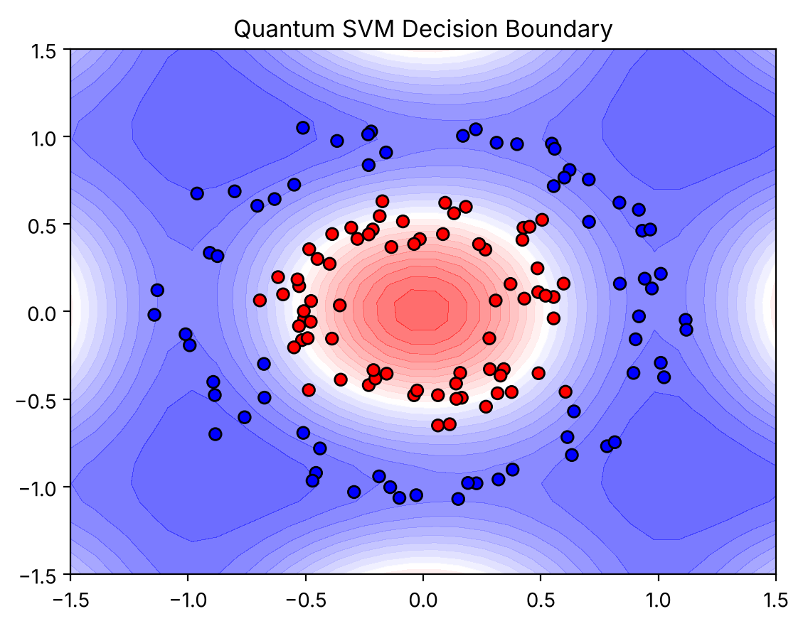
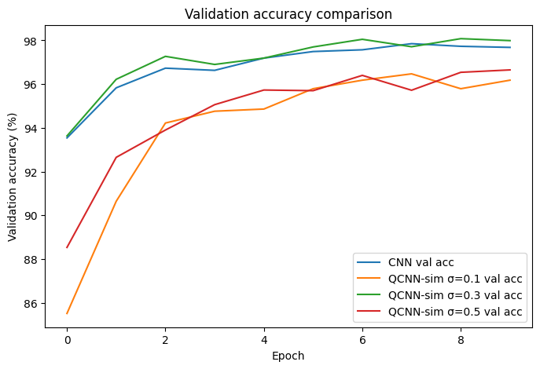
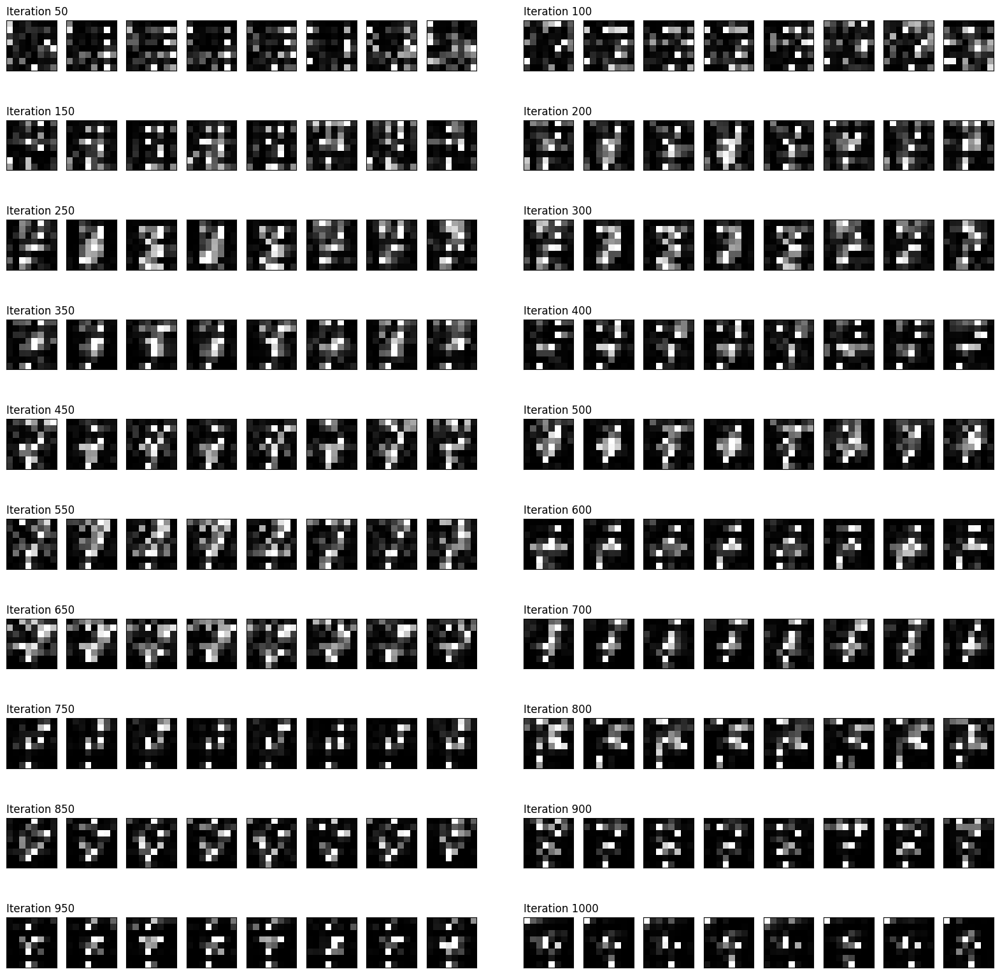

# Quantum Machine Learning Demos

Three Jupyter notebooks exploring quantum machine learning on simulators: a quantum-kernel SVM, a quantum-inspired CNN on MNIST, and a quantum GAN that generates handwritten digits.

They were built by the Quantum AI team at [Monash DeepNeuron](https://www.deepneuron.org/), a student AI and HPC team at Monash University, which I founded and led across two semesters in 2025. Each notebook explains the idea behind the method before the code, so it can be read as a walkthrough.

| Notebook | Method | Runs on | Result |
|---|---|---|---|
| [`qsvm/qsvm_demo.ipynb`](qsvm/qsvm_demo.ipynb) | SVM with a 2-qubit quantum kernel | PennyLane simulator | 100% test accuracy on a toy noisy-circles dataset |
| [`qcnn/qcnn_mnist_demo.ipynb`](qcnn/qcnn_mnist_demo.ipynb) | CNN with simulated quantum sampling (Kerenidis et al.) | PyTorch | ~98% MNIST validation accuracy, on par with a classical CNN |
| [`qgan/qgan_digits_demo.ipynb`](qgan/qgan_digits_demo.ipynb) | Patch quantum GAN, 5-qubit generators | PennyLane simulator + PyTorch | Learns rough 8×8 images of the digit 7 |

## Quantum-kernel SVM

A classical SVM can separate data that isn't linearly separable by comparing points through a kernel. Here the kernel is computed by a quantum circuit: each 2-D point is encoded into a 2-qubit state with Hadamard, RZ and CNOT gates, and the kernel value is the overlap between two encoded states. The SVM is then trained on the precomputed kernel matrix with scikit-learn.

On 200 points of the noisy-circles dataset (70/30 split) it reaches 99.3% train and 100% test accuracy. The dataset is easy, so the point is to show the pipeline end to end, not a quantum advantage.

<p align="center"></p>

## Quantum-inspired CNN on MNIST

Kerenidis, Landman and Prakash (2020) describe a quantum algorithm for CNN layers whose output is approximate: amplitudes are estimated with noise, activations are capped, and only a sampled fraction σ of each feature map is read out. This notebook **simulates those effects classically** inside a small PyTorch CNN, to see how much accuracy survives them. It does not run a quantum circuit; a Qiskit drawing of a QCNN layer is included for illustration.

Trained for 10 epochs on an 8,000-image MNIST subset, the σ = 0.3 model reaches about 98% validation accuracy, on par with the classical CNN (about 97.7%). Sampling less (σ = 0.1) costs about 1.5 points. These are single runs, so differences under a point are within noise.

<p align="center"></p>

## Quantum GAN

A generative adversarial network where the **generator is a quantum circuit**. Following the patch method, four 5-qubit sub-generators (one ancilla each, depth 6) each produce a strip of an 8×8 image, and a small classical network acts as the discriminator. It is trained on the digit 7 from the UCI Optical Recognition of Handwritten Digits dataset.

Over 1,000 iterations some samples begin to resemble a 7 (clearest around iterations 650–700), but training is unstable, as is common for small GANs. Adapted from the PennyLane [Quantum GANs demo](https://pennylane.ai/qml/demos/tutorial_quantum_gans/); see [`qgan/NOTICE.md`](qgan/NOTICE.md).

<p align="center"></p>

## Running the notebooks

```bash
git clone https://github.com/scdhong/quantum-ml-demos.git
cd quantum-ml-demos
pip install -r requirements.txt
jupyter notebook
```

All three also run in Google Colab. MNIST and the UCI digits dataset download automatically on first run. The QCNN notebook trains four models and takes about 20 minutes on a CPU; a GPU runtime is faster.

## Team

- **Semester 1, 2025 (QSVM):** Seung Chan (Daniel) Hong, Min Hao, Sanket Shivashankaran, Daniel Arnould
- **Semester 2, 2025 (QCNN, QGAN):** Seung Chan (Daniel) Hong, Nathan Wong, Min Hao

Project posters: [semester 1](https://scdhong.github.io/data/Quantum_AI_poster_S1_2025.pdf), [semester 2](https://scdhong.github.io/data/Quantum_CV_GenAI_poster_S2_2025.pdf).

AI assistants (ChatGPT, Gemini) were used for parts of the code and documentation, as noted in the notebooks.

## References

1. I. Cong, S. Choi, M. D. Lukin. [Quantum Convolutional Neural Networks](https://arxiv.org/abs/1810.03787). *Nature Physics*, 2019.
2. I. Kerenidis, J. Landman, A. Prakash. [Quantum Algorithms for Deep Convolutional Neural Networks](https://arxiv.org/abs/1911.01117). ICLR, 2020.
3. J. Ellis. [Quantum GANs](https://pennylane.ai/qml/demos/tutorial_quantum_gans/). PennyLane Demos, 2022.
4. PennyLane. [Quantum feature map](https://pennylane.ai/qml/glossary/quantum_feature_map). PennyLane QML Glossary.

## License

MIT, except the QGAN notebook, which is adapted from Apache-2.0 licensed PennyLane material (see [`qgan/NOTICE.md`](qgan/NOTICE.md)).
